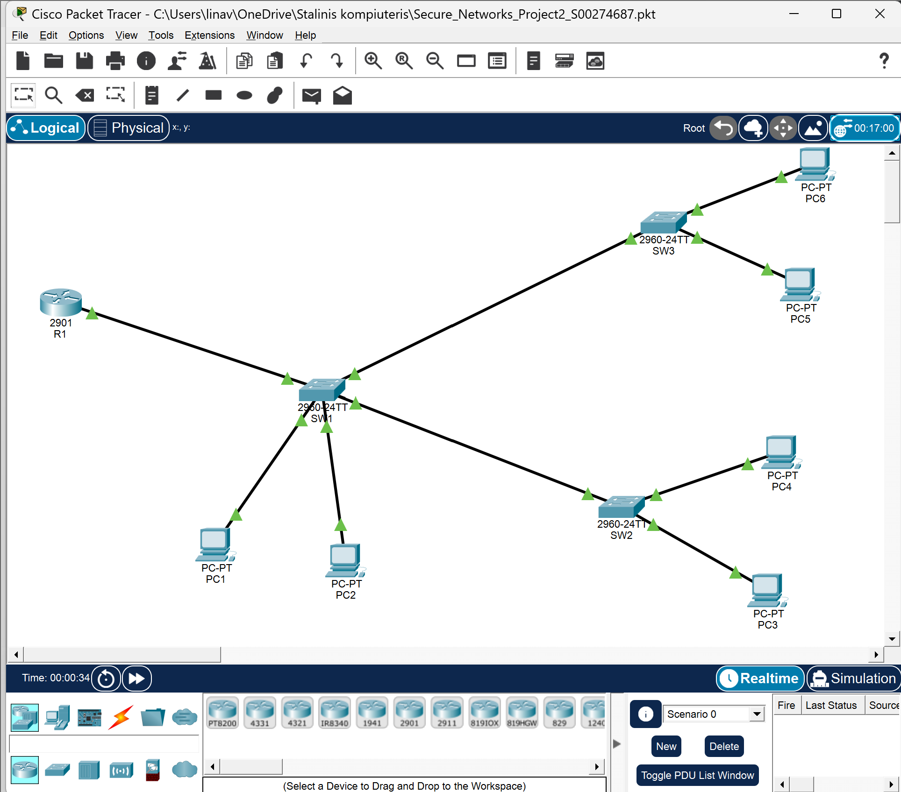

# Secure Networks Project

Cisco Packet Tracer networking project completed as part of the Secure Networks module at Atlantic Technological University (ATU).

## Project Overview

This project involved designing and configuring a secure network using Cisco Packet Tracer. The network includes multiple VLANs, Router-on-a-Stick InterVLAN Routing, SSH remote management, Access Control Lists (ACLs), Port Security, and VLAN Trunking.

## Network Topology

The network was designed and configured using Cisco Packet Tracer 9.0.

It consists of one Cisco router, three switches, and six PCs, with VLAN segmentation, inter-VLAN routing, and network security configurations.

## Network Components

* 1 Cisco Router
* 3 Cisco Switches
* 6 PCs
* Multiple VLANs
* Management VLAN 100
* Native VLAN 150

## Features Implemented

### VLAN Configuration

* Three user VLANs
* VLAN 100 Management VLAN
* VLAN 150 Native VLAN

### Routing

* Router-on-a-Stick InterVLAN Routing
* Router subinterfaces configured for each VLAN
* Default Gateway configuration

### Security

* Standard Access Control List (ACL)
* SSH Version 2
* 1024-bit RSA Encryption
* Port Security with Sticky MAC Addresses

### Network Management

* Management VLAN configuration
* Switch Management Interfaces
* Default Gateway configuration on switches

### Verification and Testing

The following Cisco IOS commands can be used to verify the network configuration:

| Command | Purpose |
|---|---|
| `show vlan brief` | Verify VLANs and assigned switch ports. |
| `show interfaces trunk` | Check trunk links and allowed VLANs. |
| `show ip interface brief` | Verify interface IP addresses and status. |
| `show ip route` | Check the router's routing table. |
| `show access-lists` | Inspect configured ACL rules. |
| `show port-security` | Check port security status. |
| `show ip ssh` | Verify SSH configuration. |
| `ping` | Test connectivity between devices and VLANs. |

These commands provide a way to check VLAN segmentation, inter-VLAN routing, trunk configuration, and network security.

## Skills Demonstrated

* IPv4 Addressing and Subnetting
* VLAN Design and Configuration
* Trunking
* InterVLAN Routing
* Network Security
* Access Control Lists
* SSH Configuration
* Port Security
* Network Troubleshooting

## Software Used

* Cisco Packet Tracer 9.0

## Author

Lina Venckus (Venckuviene)

Computer Science Graduate

Atlantic Technological University (ATU)

